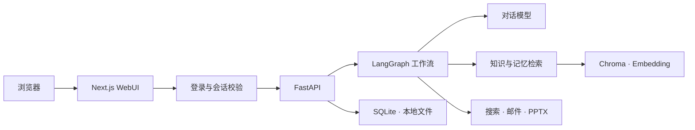

<p align="center">
  
</p>

<p align="center">
  <strong>把资料变成知识，把讨论变成行动，让重要的事跨越每次对话。</strong>
</p>

<p align="center">
  
  
  
  
  
</p>

<p align="center">
  <a href="#界面预览">界面预览</a> ·
  <a href="#可以做什么">功能介绍</a> ·
  <a href="#快速开始">快速开始</a> ·
  <a href="#文档导航">项目文档</a>
</p>

---

Cortex 是一个面向个人的 AI 工作空间。它把对话、PDF 知识库、长期记忆、会议分析、风险待办和演示文稿放在同一套 WebUI 中，通过 LangGraph 编排检索与工具调用。

业务数据保存在本机，模型推理、Embedding、联网搜索和邮件发送按配置调用外部服务。**本地保存不等于完全离线：启用相关功能时，所需文本会发送给对应服务商。**

## 界面预览

<!-- CORTEX_SCREENSHOTS_START -->
> 真实界面截图正在补充。运行 `bash scripts/capture_readme.sh` 可采集登录页并自动更新此处；工作空间与知识库截图参见 [截图指南](docs/screenshots/README.md)。
<!-- CORTEX_SCREENSHOTS_END -->

## 可以做什么

| 模块 | 从输入到结果 |
| :--- | :--- |
| **对话与搜索** | 连续对话、流式回答，按需检索资料和记忆；联网搜索返回可追溯来源。 |
| **PDF 知识库** | 上传、解析、检索、重新解析与删除；引用同时定位 **PDF 页码 + TXT 段落**，支持提取文本预览和下载。 |
| **会议分析** | 从会议 TXT 提取摘要、决定、行动项和风险；支持多会议搜索、筛选与删除。 |
| **长期记忆** | 从聊天与会议提取明确事实，或手动录入；支持人物、时间、地点、主题筛选及原文追溯。 |
| **风险待办** | 跟踪责任人和期限、标记完成、删除待办；配置 SMTP 后发送风险提醒并查看发送结果。 |
| **演示文稿** | 输入主题与受众，生成 5–20 页 `.pptx`；支持下载和删除生成文件。 |

**围绕来源设计。** 文档回答可以定位提取文本，记忆保留原文证据，会议风险附带出处。检索结果和模型提取仍需核对，不将生成内容当作已经人工审核的结论。

**围绕个人工作空间设计。** 登录后使用六个工作区；侧栏底部的「个人工作空间」集中管理账号、修改密码、服务状态与邮件设置。

## 快速开始

当前安装流程面向 Linux，使用项目目录内的 Conda 环境。需要先准备 Conda；已有环境的用户可直接进入第 3 步。

### 1. 安装依赖

在克隆后的项目根目录执行：

```bash
conda create --prefix ./.conda/ai-brain -c conda-forge python=3.11 nodejs=24 pip -y
conda activate "$PWD/.conda/ai-brain"

python -m pip install -r requirements.lock.txt
cd frontend
npm ci
cd ..
```

无需再次运行 `create-next-app` 或初始化 shadcn。网络受限时，参考 [安装说明](安装书.md) 和 [服务器迁移说明](服务器迁移安装说明.md)。

### 2. 配置外部服务

```bash
cp -n .env.example .env
chmod 600 .env
```

编辑 `.env`，填写自己的配置；不要覆盖已有密钥文件，也不要提交真实密钥。

| 配置 | 用途 |
| :--- | :--- |
| `CHAT_BASE_URL` / `CHAT_API_KEY` / `CHAT_MODEL` | 对话、会议分析、记忆提取和 PPT 大纲；示例配置使用 DeepSeek。 |
| `EMBEDDING_API_FORMAT` / `EMBEDDING_BASE_URL` / `EMBEDDING_API_KEY` / `EMBEDDING_MODEL` | PDF 和记忆向量检索；支持 OpenAI 兼容与 DashScope 原生格式，独立于聊天模型。 |
| `SEARCH_PROVIDER` | 选择 DeepSeek 或 Tavily 搜索；Tavily 使用独立的 `TAVILY_API_KEY`。 |
| SMTP 设置 | 可在「待办事项 → 邮件设置」中配置邮箱、授权码和收件人；保存后立即生效。 |

配置模板中的模型和地址应以自己的服务商控制台为准。邮件设置保存到本机，界面不返回已保存的授权码。

### 3. 启动并登录

```bash
bash scripts/dev.sh
```

打开 **<http://localhost:3000>**。首次启动会在本机生成随机初始凭据：

```bash
# 在另一个终端执行
cat storage/initial-login.txt
```

首次登录必须修改密码。忘记密码或需要更换账号时，在服务器终端执行：

```bash
.conda/ai-brain/bin/python scripts/account.py
```

<details>
<summary><strong>同一路由器下，让其他电脑访问</strong></summary>

停止旧服务和旧的 `cloudflared` 进程后执行：

```bash
bash scripts/dev.sh lan
```

脚本自动识别局域网 IP、配置准确的来源白名单，并打印访问地址。其他设备打开该地址后仍须登录。检测失败时可指定 IP：

```bash
CORTEX_LAN_IP=192.168.1.100 bash scripts/dev.sh lan
```

示例 IP 请替换为实际地址。防火墙仅对可信局域网放行 `3000/TCP`，不开放 `8000`。LAN 模式会清空公网 HTTPS Origin，使用 HTTP，仅适合可信局域网临时访问。

</details>

## 工作原理



| 层次 | 实现 |
| :--- | :--- |
| 界面 | Next.js、React、TypeScript、Tailwind CSS、shadcn、Lucide、Motion |
| 服务与编排 | FastAPI、Pydantic、LangGraph |
| 文档与产物 | PyMuPDF 提取文字，python-pptx 生成演示文稿 |
| 持久化 | SQLite 保存业务记录与 checkpoint，Chroma 保存向量 |
| 外部能力 | 可配置的聊天模型、Embedding、搜索 API 和 SMTP |

## 项目结构

```text
├── backend/app/       # API、鉴权、Agent 工作流与业务服务
├── backend/tests/     # 业务与安全回归测试
├── frontend/src/      # 登录页、六个工作区与个人菜单
├── scripts/           # 安装、启动、账号管理、检查与截图工具
├── samples/           # 小型 PDF / 会议测试样例
├── docs/              # GitHub 展示资源、截图指南及历史 README
├── .env.example       # 不包含真实凭据的配置模板
└── storage/           # 本地运行数据，自动创建，不提交 Git
```

## 验证与使用边界

```bash
# 使用临时账号和数据验证业务、安全逻辑及前端类型
bash scripts/test.sh

# 仅检查配置，不调用外部服务、不展示密钥
.conda/ai-brain/bin/python scripts/check_services.py
```

添加 `--live` 会实际请求已配置的模型、Embedding、搜索，并检查 SMTP 登录；可能产生 API 费用，但该检查不会发送邮件。邮件投递可通过待办中的「重试邮件」单独验证。

- 当前是**单账号、单进程**工作空间，没有多租户数据隔离或团队权限管理。
- PDF 需要文字层，暂未启用 OCR；支持最大 20 MB、500 页，会议 TXT 最多 60000 字。
- 聊天采用最近消息窗口和长度截断，尚未实现自动上下文压缩。
- 后台任务不是持久化任务队列，服务重启后中断任务需手动重试。
- SMTP 提醒发送到配置的收件人白名单，不自动将责任人名称转换为邮箱。
- 自动化测试不等同于真实模型、邮件投递、浏览器或公网部署验收。

## 数据与访问安全

登录密码使用 scrypt 哈希；业务 API 与文件下载统一鉴权，并提供登录限速、会话撤销、Origin / Host / CSRF 校验。实际密钥不放入前端源码，`.env`、运行数据、依赖和本地文档已由 `.gitignore` 排除。

**密钥文件仍是本地明文文件，没有磁盘级加密。** 服务器账号、文件权限和备份需要单独保护。公网部署应使用生产构建、准确的 HTTPS Origin 和入口访问控制；不要直接公开开发服务器、后端端口或 `storage/`。

完整说明见 [登录与安全说明](登录与安全说明.md)。

## 文档导航

| 文档 | 内容 |
| :--- | :--- |
| [开发书](开发书.md) | 项目目标、功能需求与原始设计 |
| [项目架构书](项目架构书.md) | 模块职责、数据流和 API 接口 |
| [安装书](安装书.md) | 环境准备与网络源配置 |
| [服务器迁移安装说明](服务器迁移安装说明.md) | 新服务器安装、运行与迁移 |
| [登录与安全说明](登录与安全说明.md) | 账号管理、局域网访问与公网使用边界 |
| [截图指南](docs/screenshots/README.md) | 真实界面截图与发布前隐私检查 |

<details>
<summary>查看改版前的 README</summary>

原文件完整保存在 [docs/archive/README.before-github.md](docs/archive/README.before-github.md)，用于历史查阅；其中的旧说明不代表当前实现。

</details>
