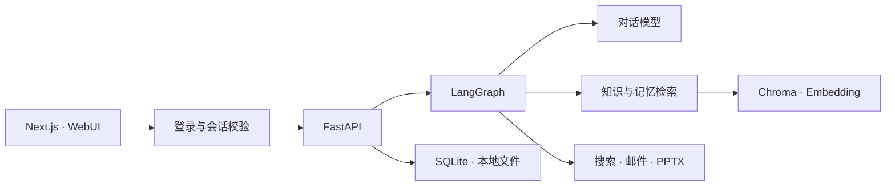

<p align="center">
  
</p>

<p align="center"><strong>你的知识、记忆与行动，始终在线。</strong></p>
<p align="center">一个面向个人的 AI 工作空间：读资料、查信息、记住事实，让讨论走向下一步。</p>

<p align="center">
  
  
  
  
</p>

<p align="center">
  <a href="#界面预览">界面预览</a> · <a href="#核心能力">核心能力</a> · <a href="#快速开始">快速开始</a> · <a href="#项目文档">项目文档</a>
</p>

## 界面预览

<!-- CORTEX_SCREENSHOTS_START -->


<p align="center"><sub>六个工作区，一个入口。对话、资料与上下文在同一屏中连接。</sub></p>

<table>
<tr><td width="50%"><a href="截图/对话-联网查询.png"></a><br /><strong>对话 · 联网查询</strong><br /><sub>结合搜索来源，回答时效性问题。</sub></td><td width="50%"><a href="截图/pdf解析-RAG知识库.png"></a><br /><strong>知识库 · PDF 解析</strong><br /><sub>管理资料，查看原文与提取文本。</sub></td></tr>
<tr><td width="50%"><a href="截图/会议纪要-分析风险.png"></a><br /><strong>会议 · 风险分析</strong><br /><sub>提炼会议摘要、行动项与潜在风险。</sub></td><td width="50%"><a href="截图/长期记忆.png"></a><br /><strong>记忆 · 跨会话积累</strong><br /><sub>保存事实，筛选记忆，追溯原始证据。</sub></td></tr>
</table>

<details>
<summary>演示文稿 · 从主题到 PowerPoint（点击展开）</summary>


</details>

<details>
<summary>待办与邮件设置（点击展开）</summary>


</details>

<!-- CORTEX_SCREENSHOTS_END -->

## 核心能力

| 能力 | 你可以做什么 |
| :--- | :--- |
| **对话与联网搜索** | 连续对话、流式回答，按需检索知识与记忆，并追溯搜索来源。 |
| **PDF 知识库** | 上传、重新解析、删除文档；回答定位到 **PDF 页码 + TXT 段落**。 |
| **会议分析** | 从会议 TXT 提取摘要、决定、行动项和风险，独立管理多场会议。 |
| **长期记忆** | 自动提取明确事实或手动录入，按人物、时间、地点、主题检索。 |
| **待办与邮件** | 跟踪责任人和期限、完成或删除待办，配置 SMTP 发送风险提醒。 |
| **演示文稿** | 按主题生成 5–20 页 PowerPoint，下载真实 `.pptx` 文件。 |

业务数据保存于本机；模型推理、Embedding、搜索和邮件按配置调用外部服务，**并非完全离线运行**。

## 快速开始

需要 Linux、Conda，以及自己的模型服务配置。已安装环境的用户可直接启动。

**1. 安装环境与依赖**

```bash
conda create --prefix ./.conda/ai-brain -c conda-forge python=3.11 nodejs=24 pip -y
conda activate "$PWD/.conda/ai-brain"
python -m pip install -r requirements.lock.txt
cd frontend
npm ci
cd ..
```

**2. 配置服务**

```bash
cp -n .env.example .env
chmod 600 .env
```

编辑 `.env`：配置聊天模型、Embedding 和搜索服务。聊天与 Embedding 使用独立配置；邮件可在网页「待办事项 → 邮件设置」中填写。字段说明见 [.env.example](.env.example)。

**3. 启动并登录**

```bash
bash scripts/dev.sh
```

打开 **<http://localhost:3000>**。在另一终端查看首次生成的随机凭据，登录后修改密码：

```bash
cat storage/initial-login.txt
```

<details>
<summary>局域网访问 · 账号重置 · 检查与测试</summary>

```bash
# 同一路由器访问：停止旧服务后启动，使用终端打印的地址
bash scripts/dev.sh lan

# 在服务器终端重置账号或密码
.conda/ai-brain/bin/python scripts/account.py

# 仅检查配置是否填写，不调用外部服务
.conda/ai-brain/bin/python scripts/check_services.py

# 业务、安全回归测试与前端类型检查
bash scripts/test.sh
```

LAN 模式使用 HTTP，会更新局域网来源白名单并清空公网 HTTPS Origin，仅用于可信局域网临时访问。需要时只对局域网放行 `3000/TCP`，不开放后端 `8000`。

全新服务器安装、镜像源选择与生产运行方式，见 [服务器迁移安装说明](服务器迁移安装说明.md)。

</details>

## 技术架构



前端使用 React、TypeScript 与 Tailwind CSS；后端以 LangGraph 编排工作流，使用 PyMuPDF 提取 PDF 文字、python-pptx 生成演示文稿。模块与接口见 [项目架构书](项目架构书.md)。

## 使用边界

- 当前为**单账号、单进程**工作空间；PDF 需要文字层，尚未启用 OCR。
- 聊天使用最近消息窗口和长度截断，尚未实现自动上下文压缩。
- `.env` 与 `storage/` 不提交 Git。密钥仍是受文件权限保护的本地明文，未做磁盘级加密。
- 公网运行需使用生产构建、HTTPS 和入口访问控制；模型内容与来源仍需核对。

账号、会话和部署防护详见 [登录与安全说明](登录与安全说明.md)。

## 项目文档

| 文档 | 内容 |
| :--- | :--- |
| [开发书](开发书.md) | 项目目标与功能设计 |
| [项目架构书](项目架构书.md) | 模块职责、数据流与接口 |
| [安装书](安装书.md) · [服务器迁移](服务器迁移安装说明.md) | 环境安装与部署运行 |
| [登录与安全说明](登录与安全说明.md) | 账号管理、局域网与公网使用边界 |

<details>
<summary>历史 README</summary>

[最初版本](docs/archive/README.before-github.md) · [截图改版前版本](docs/archive/README.before-gallery.md)

</details>
