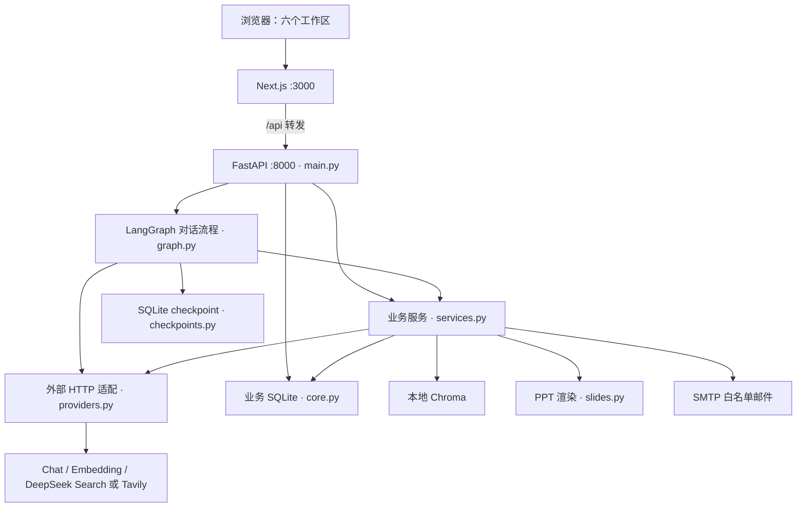

# Cortex（AI 外脑）项目架构书

> 依据当前代码整理，2026-10-28。《开发书.md》定义目标，本文说明实际实现、模块位置及接口边界。

## 1. 总体架构

单账号所有者、单机部署，业务 API 全部需要登录会话。Next.js 提供界面和 API 转发，FastAPI 执行业务，SQLite 保存事实与状态，Chroma 保存向量。模型、搜索和 SMTP 是外部服务。



HTTP 路由统一在 [backend/app/main.py](backend/app/main.py)；API 文档 `/docs`、`/redoc` 和 `/openapi.json` 已关闭。前端转发规则在 [frontend/next.config.ts](frontend/next.config.ts)，默认转发到 `http://127.0.0.1:8000`。

## 2. 代码模块及职责

### 2.1 后端

| 文件 | 设计职责 | 主要入口 |
|---|---|---|
| [main.py](backend/app/main.py) | 装配应用、HTTP 路由、SSE、进程内作业、会话锁、异常响应；启动和停止 checkpoint | `create_app()`、内部 `start_job()` |
| [core.py](backend/app/core.py) | 根目录 `.env` 配置、SQL 表结构、SQLite 短事务、ID/时间、受控文件路径 | `Settings`、`Database`、`AppError` |
| [schemas.py](backend/app/schemas.py) | 请求和模型输出的 Pydantic 结构、枚举及长度限制 | `ChatInput`、`MeetingAnalysis`、`MemoryFact`、`SlidesInput`、`SlideDeck`、`Intent` |
| [graph.py](backend/app/graph.py) | 组装对话执行图；检索、搜索/PPT、回答及记忆提取；发出流事件 | `build_graph()`、`ChatState` |
| [checkpoints.py](backend/app/checkpoints.py) | 为异步图提供 SQLite checkpoint 读写；短事务直接在所属事件循环执行 | `LocalSqliteSaver` |
| [providers.py](backend/app/providers.py) | Chat 结构化输出/流式请求、Embedding、DeepSeek/Tavily 搜索；统一网络错误 | `Providers.structured/stream/embed/search()` |
| [services.py](backend/app/services.py) | PDF、会议、记忆、向量索引、邮件、PPT 作业编排 | `Services`，详见第 3 节 |
| [slides.py](backend/app/slides.py) | 将校验后的大纲渲染为真实 PPTX；固定版式、图表和文字容量检查 | `render_deck()`、`text()` |

这些职责目前集中在上述文件中，尚未拆成独立的 `api/`、`models/` 或多个微服务。数据库使用标准库 `sqlite3` 和手写 SQL，**未使用 ORM**。

### 2.2 前端

| 文件 | 设计职责 |
|---|---|
| [app/page.tsx](frontend/src/app/page.tsx) | 首页入口，挂载 `Workspace` |
| [app/layout.tsx](frontend/src/app/layout.tsx) | 中文页面、元信息、全局样式 |
| [components/workspace.tsx](frontend/src/components/workspace.tsx) | 六个工作区、会话切换、上传、待办、配置状态；解析 SSE；约每 5 秒刷新列表 |
| [lib/api.ts](frontend/src/lib/api.ts) | 通用 JSON/FormData 请求、前端数据类型、链接协议过滤；聊天流在 `workspace.tsx` 中单独请求 |
| [components/markdown.tsx](frontend/src/components/markdown.tsx) | 基础 Markdown 展示，不执行原始 HTML |
| [components/ui/button.tsx](frontend/src/components/ui/button.tsx) | shadcn 按钮组件 |
| [app/workspace.css](frontend/src/app/workspace.css) | 三栏布局、工作区样式和移动端适配；由 `globals.css` 引入 |

六个工作区通过 React 状态切换，当前都位于 `/`，不是六条独立页面路由。浏览器只请求同源 `/api/*`，不持有外部服务密钥。

## 3. 六项业务如何实现

### 3.1 连续对话

入口：`POST /api/chat/stream` → `graph.py:build_graph()`。

```text
校验会话/所选文件 → 获取会话锁 → 保存用户消息
→ intent → retrieve → tools → answer → remember → done
```

- `intent`：模型输出 `Intent`；搜索开关或“今天/最新/近期/联网/搜索”可强化搜索选择，PPT 意图保留。
- `retrieve`：按意图中的 `use_knowledge/use_memory` 分别启用 PDF 与长期记忆检索；已选 `file_ids` 启用对应 PDF。仅写入记忆（`memory_write=true`）或无需来源的普通聊天跳过检索，未授权使用知识的 PPT 请求也跳过。
- `tools`：按意图执行搜索或 PPT；普通聊天直接通过。当前是固定顺序执行图，不是无限工具循环。
- `answer`：取最近 20 条消息、过滤失败记录，每条最多 12000 字；加入来源和北京时间，流式生成后保存回答。
- `remember`：仅从本轮用户文本提取事实。记忆失败返回 warning，不撤销已经保存的回答。
- `thread_id=conversation_id`，checkpoint 保存图状态；界面历史和模型上下文主要从业务 `messages` 表读取。

### 3.2 PDF 知识问答

入口：`POST /api/files/upload` → `Services.process_pdf()`；问答复用 `Services.retrieve()`。

```text
校验 PDF → 受控路径保存 → 创建作业 → 提取文字与页码
→ 原始页文本保存到 extracted/<文件ID>.txt
→ 900 字分块、700 字步长 → chunks 入库 → Embedding → Chroma
→ 问答检索 → 文件名/PDF 页码/TXT 段落范围及定位链接
```

默认上传限制 20 MB；PDF 最多 500 页，累计分块文本超过 100 万字时拒绝。拒绝损坏、加密或无可提取文字的 PDF；未启用 OCR。

重新解析前按文件 ID 清理历史向量，避免重复索引；删除期间先暂存原文件，若索引清理或 SQL 事务失败则恢复原文件并反馈失败。SQLite 与 Chroma 之间仍无分布式事务，失败后可重新解析修复索引。

向量检索最多返回 8 条，再与结构化记忆结果去重、优先排列 PDF，最终最多提供 12 条来源。`file_ids` 可限制 PDF 范围，只有本轮启用记忆检索时才联合检索长期记忆。Chroma 查询按启用的来源类型过滤。原文接口 `/api/files/{key}/content#page=N` 打开对应页。

### 3.3 会议分析与风险待办

入口：上传 TXT → `Services.process_meeting()`。

```text
UTF-8/GB18030 解码 → 给原文加行号供分析 → MeetingAnalysis
→ 原文证据与责任人存在性校验 → 保存会议
→ 风险去重并创建 tasks → 保存长期事实 → 尝试发送风险邮件
```

TXT 最多 60000 字。风险类别固定为截止时间风险、责任人缺失、进度阻塞、未解决问题；等级为 `high/medium/low`。事实不明确时允许 `null`，模糊日期保留原文。

证据校验忽略空白后检查是否为原文子串；它证明“引文存在”，不等于独立证明模型的风险判断正确。行号用于模型分析，当前未单独存储证据起止行字段。无风险时不创建风险待办、不发风险邮件。

### 3.4 长期记忆

入口：`Services.extract_memory()`、`save_memories()`、`retrieve()`、`reindex()`。

- 来源为用户聊天消息、会议或手动录入（`source_type=manual`）；保存人物、时间、地点、主题、摘要、证据、置信度和来源 ID。
- SQLite 保存结构化事实，Chroma 保存摘要向量；Embedding 失败时保留事实，`index_status=pending`。
- 检索同时使用 SQLite 文本/人物/主题匹配和向量检索；结构化候选按更新时间倒序。
- 唯一键为 `(source_type, source_id, evidence)`，避免同一来源证据重复写入；不同来源记录保留，不覆盖历史。
- 手动新建调用 `create_memory(MemoryInput)`，摘要必填（1–1000 字），人物/时间/地点/主题可选（各最多 150 字），原文说明可选（最多 2000 字，默认摘要）。不调用 LLM，先入库再建索引，失败保留待索引记录并返回 warning。手动记录的 confidence 固定为 1，仅表示用户录入，页面不显示为模型置信度。
- 删除调用 `delete_memory(key)`，先清理所有 `brain-*` 集合中对应 memory_id 向量，再删数据库；清理失败保留记录并标为 pending，返回 502，可重试。索引写入前检查记录仍存在，避免并发重建恢复已删除记忆。原聊天/会议保留。
- `/api/memories/{key}/source` 返回手动原文说明、对应聊天原文或会议 TXT；`reindex` 只重建未就绪的记忆索引，不重建全部 PDF。

### 3.5 实时搜索

入口：图的 `tools` 节点 → `Providers.search()`。

| 模式 | 认证与请求 | 选择规则 |
|---|---|---|
| DeepSeek | 复用 `CHAT_API_KEY`，Bearer 认证，请求 `POST https://api.deepseek.com/v1/tools/search` | `SEARCH_PROVIDER=deepseek`；或 auto 且 Chat 主机为 `api.deepseek.com` |
| Tavily | 使用 `TAVILY_API_KEY`，请求 `POST https://api.tavily.com/search` | `SEARCH_PROVIDER=tavily`；或其他 Chat 主机下的 auto |

搜索结果统一为 `title/url/content/published_date`，仅保留 HTTP(S) 来源，再交给模型组织回答。DeepSeek 查询最多 128 字、请求 5 条结果；“今天/今日”替换为北京时间日期。空结果、密钥错误、余额不足、限流和网络错误均明确反馈。

搜索能力来自独立 Search 请求；仅调用 Chat 接口不会自动联网。当前没有独立的公开 `/api/search` 路由。

### 3.6 PPT 生成

入口：`POST /api/slides`，或聊天 PPT 意图 → `Services.create_slides()` → `slides.render_deck()`。

```text
主题/页数/受众/风格 → 可选检索用户知识 → SlideDeck
→ 校验页数、五种版式 → 渲染 16:9 PPTX → 保存 artifacts → 下载
```

页数为 5–20，必须覆盖封面、章节、双栏、图表、总结。图表要求分类/数值等长且有数据说明；要点、标签和文本框容量有确定性限制，字号会按估算缩小，仍超限则失败。仅用户明确允许时加入 PDF/会议知识。

生成文件是真实 `.pptx`；视觉排版采用容量估算，仍需在实际办公软件检查字体与显示效果。模型给出的图表说明不等于数据已经独立核验。

## 4. HTTP 接口清单

**下列全部路由定义在 `backend/app/main.py`。** `{key}` 是对应对象的服务端 ID。

| 方法 | 路径 | 输入 / 主要输出 |
|---|---|---|
| GET | `/api/health` | 配置存在性、模型名、搜索服务类型；不执行外部连通测试 |
| GET | `/api/conversations` | 会话列表 |
| POST | `/api/conversations` | `{title}` → 新会话，201 |
| PATCH | `/api/conversations/{key}` | `{title}` → 重命名 |
| GET | `/api/conversations/{key}/messages` | 消息列表，包含解析后的 `metadata` |
| POST | `/api/chat/stream` | `{conversation_id,message,file_ids?,search?}` → SSE |
| GET | `/api/files` | 文件及解析状态 |
| POST | `/api/files/upload` | multipart 字段 `file` → `{file_id,job_id,duplicate,...}`，202 |
| POST | `/api/files/{key}/retry` | 仅失败文件可重试 → 新 `job_id`，202 |
| POST | `/api/files/{key}/reparse` | 对非解析中 PDF 重新提取文本、分块和建索引 → `{file_id,job_id}`，202 |
| DELETE | `/api/files/{key}` | 按文件类型删除 PDF 或会议 TXT；PDF 清理原文/提取文本/向量/分块/任务；会议清理范围见下文 |
| GET | `/api/files/{key}/content` | PDF 二进制或 TXT 原文 |
| GET | `/api/files/{key}/text` | PDF 的 UTF-8 提取文本；`download=true` 附件下载；`paragraph=N&end=M` 返回带锚点和范围高亮的 HTML 预览（下载优先）；旧 PDF 按需补生成带段号 TXT，不调用模型 |
| GET | `/api/jobs` | 最近最多 100 项作业 |
| GET | `/api/jobs/{key}` | 作业状态、进度、结果 ID、错误/提示 |
| GET | `/api/meetings` | 会议、`analysis` 和对应风险待办 |
| DELETE | `/api/meetings/{key}` | 以会议 ID 删除会议原文、分析、待办/邮件记录、会议记忆及各模型向量、相关作业；分析或发送邮件中返回 409 |
| GET | `/api/settings/smtp` | 邮件设置与 password_set/configured 状态，不返回密码 |
| PUT | `/api/settings/smtp` | SMTP 账号、服务器、加密、授权码、收件人；保存本地并立即生效，不发信；密码留空保留，发送中拒绝修改（409） |
| GET | `/api/tasks` | 待办与对应 `email_logs` |
| DELETE | `/api/tasks/{key}` | 删除待办和邮件记录，保留会议及记忆；发送中返回 409 |
| PATCH | `/api/tasks/{key}` | `{status:"open"或"done"}` → 更新待办 |
| POST | `/api/tasks/{key}/retry-email` | 重试邮件 → 待办状态及失败原因 |
| GET | `/api/memories` | 可选 `q/person/time/location/topic` → 最多 200 条记忆 |
| POST | `/api/memories` | `MemoryInput` → `{memory,warning}`，201；手动录入事实并尝试建立向量索引 |
| DELETE | `/api/memories/{key}` | 删除记忆及各历史模型索引 → `{memory_id,deleted}`；未知 ID 为 404 |
| POST | `/api/memories/reindex` | 重建待处理记忆索引 → `{indexed}` |
| GET | `/api/memories/{key}/source` | 记忆对应的原始文本 |
| POST | `/api/slides` | `{topic,pages?,audience?,style?,use_knowledge?}` → `{job_id}`，202 |
| GET | `/api/artifacts` | 生成文件元信息 |
| DELETE | `/api/artifacts/{key}` | 删除生成文件、下载记录及不再被产物引用的生成作业；生成中返回 409 |
| GET | `/api/artifacts/{key}/download` | PPTX 附件下载 |

输入约束以 `schemas.py` 与 OpenAPI 为准。多数输出目前直接由字典/SQL 结果组装，**未全面声明 `response_model`**；前端类型在 `lib/api.ts`，不是运行时响应校验器。

### SSE 与错误约定

每个事件编码为 `data: <JSON>\n\n`，JSON 的 `type` 为：

| type | 主要字段 | 含义 |
|---|---|---|
| `status` / `delta` / `warning` / `error` | `content` | 执行状态、模型文本片段、非致命提示、失败 |
| `sources` | `sources` | 来源数组 |
| `artifact` | `artifact` | 可下载文件元信息 |
| `done` | 无 | 流程正常结束 |

流开始前按 HTTP 状态报错：400 业务校验、404 对象不存在、409 状态冲突、413 上传超限、422 请求结构校验；适配器错误可使用 502/503，未处理异常为 500，通常返回 `{"detail":"..."}`。422 的 `detail` 可为数组。流已开始后 HTTP 通常保持 200，前端必须检查 SSE 的 `error`，不能仅凭 HTTP 状态判成功。

## 5. 存储与一致性

定义位置：`core.py:SCHEMA`；开启 SQLite 外键和 WAL，每次数据库操作使用短事务。

| 存储 | 内容与主要关系 |
|---|---|
| `storage/brain.sqlite3` | `conversations → messages`；`files → chunks/meetings → tasks → email_logs`；`jobs → artifacts`；独立的 `memories` 来源记录 |
| `storage/checkpoints.sqlite3` | LangGraph 按会话保存的状态与写入记录 |
| `storage/chroma/` | PDF 分块、记忆摘要向量；集合名由 Embedding 地址与模型名的哈希区分 |
| `storage/uploads/` | 按服务端 ID 命名的 PDF/TXT 原文 |
| `storage/extracted/` | PDF 按物理页提取的 UTF-8 TXT；保留页文本和空白页提示，不重复输出分块重叠部分 |
| `storage/artifacts/` | 按服务端 ID 命名的 PPTX；展示文件名另存于数据库 |

关键唯一约束：`files.sha256`、`meetings.file_id`、`tasks.risk_key`、`email_logs(task_id,recipient)`、记忆来源证据组合。风险键由文件哈希、风险类别和去空白证据计算。

`jobs.result_id` 根据作业类型指向文件、会议或生成文件，不是统一外键。`memories.source_id` 根据 `source_type` 指向消息或会议，也不由 SQLite 单一外键约束。数据库初始化使用 `CREATE TABLE IF NOT EXISTS`，尚无版本化迁移系统。

## 6. 作业、邮件与故障恢复

- 作业由 `asyncio.create_task` 在 FastAPI 进程中执行，SQLite 保存状态：`queued → running → succeeded/failed`；不使用外部任务队列。
- 重启将未完成作业及解析中文件标为失败，供查询与重试，**不会自动续跑**。PPT 失败需重新发起生成。
- 会议作业成功只表示分析流程完成，邮件结果另看 `tasks.email_status`；成功作业的 `error` 字段也可能承载非致命提示。
- 邮件通过 `asyncio.to_thread` 调用标准库 SMTP；收件人仅来自服务器白名单，已向某地址发送成功的记录在重试时跳过。
- 会话锁和邮件锁均为进程内锁，因此后端按单进程部署。SMTP 确认与落库之间中断会产生不确定结果，重启标为 `unknown`，需人工核对；不保证故障下的绝对只发送一次。
- SQL、Chroma、文件系统和 SMTP 之间没有分布式事务；失败可能留下已写入的部分数据。重试依赖唯一键和状态检查，不应理解为完整业务回滚。

## 7. 配置、运行与验证入口

| 位置 | 用途 |
|---|---|
| `.env` / `.env.example` | 真实配置 / 无密钥模板；`Settings` 从项目根目录读取，修改后重启后端 |
| `CHAT_*` / `EMBEDDING_*` | 独立的聊天与向量服务配置；`EMBEDDING_API_FORMAT` 选择 openai/dashscope，向量批次最多 20 条 |
| `SEARCH_PROVIDER` / `TAVILY_API_KEY` | 搜索路由；DeepSeek 使用 Chat key |
| `SMTP_*` | 发件账户、TLS 方式与收件人白名单 |
| `API_PROXY` | HTTP 适配器专用代理，空值直连；HTTP 请求不继承 shell 代理，SMTP 不走此代理 |
| `scripts/dev.sh` | 选择项目 conda 环境，启动本机 3000/8000 端口 |
| `scripts/test.sh` | 后端测试与前端类型检查 |
| `scripts/check_services.py --live` | 真实 API/SMTP 连接检查，不发送邮件；无 `--live` 时仅检查配置存在性 |
| `backend/tests/` | 使用测试适配器的集成与搜索协议测试，不等同于真实外部服务验收 |

上传文本、网页和检索片段按不可信数据传给模型；邮件目标与文件路径由后端控制，下载经 `Database.safe_path()` 校验。提示词约束和证据检查不能视为完全消除提示注入或事实判断错误。

当前无登录、用户隔离、OCR、PPT 在线预览或多进程协调；PPT 关联知识未单独建立逐页来源表。默认仅绑定本机端口，异地访问与安装见 [服务器迁移安装说明.md](服务器迁移安装说明.md)，操作说明见 [README.md](README.md)。

### TXT 段落引用

提取时将 PyMuPDF 文本块映射到原始页文本，超长块按至多 900 字拆分（优先换行）；跨页连续编号。TXT 标注 `[TXT 第 N 段]`，检索块保留原有 900 字、步长 700 字规则，按字符跨度计算相交段落范围。段号写入 Chroma 元数据；旧索引通过原文匹配本地补算，无需重新生成向量，无法唯一匹配时仅保留页码，不猜测段号。来源同时包含 PDF `url`、TXT `text_url` 与 `paragraph_start/end`；回答要求引用给定范围，前端主链接打开高亮 TXT，附带 PDF 链接。段落是提取定位单位，不保证多栏阅读顺序或语义边界。历史聊天引用不改写。

仅写入记忆的请求优先按普通对话执行，不触发来源检索或因“今天”等字样触发联网搜索；保存记忆仍由回答后的 remember 节点执行。检索开关由模型意图识别决定，不代表已经实现逐条来源相关性审核。

### 多会议与删除管理

每份 TXT 独立对应 `files` 与 `meetings`，以文件内容 SHA256 去重；前端支持按标题/文件名/参会人/日期/摘要搜索、状态筛选、下拉选择单场或查看全部。失败文件可重试或直接通过文件 ID 删除。已分析会议也可按会议 ID 删除，两种入口调用同一个 `delete_meeting_file()`。

删除会议在同一 SQLite 事务内按外键顺序清理邮件记录、待办、来源为该会议的记忆、会议、作业与文件记录；原文先暂存，失败恢复。向量删除覆盖全部 `brain-*` 集合；失败保留记录并将相关记忆索引标为 pending。分析中、相关作业运行中或相关邮件发送中拒绝删除；已发送邮件不会撤回。其他会议、手动/聊天记忆与聊天历史保留。

待办删除入口复用于会议风险卡片和待办页，只清理该待办及邮件记录；不更改会议原始摘要、行动项和记忆。演示文稿删除移除 PPTX 文件、产物记录及不再被引用的生成作业；文件暂存与事务失败恢复处理同会议，保留聊天历史（原下载链接失效）。所有前端删除入口均先明确展示删除范围并确认，API 由统一中间件鉴权，继续沿用单账号部署方式。

### 邮件设置持久化

`mail_settings.py` 负责加载、脱敏输出与原子保存。启动时先读 `.env`，再使用 `storage/smtp-settings.json` 覆盖 SMTP 字段；设置 API 在受限临时文件写入后原子替换，权限 0600。凭据以本地明文保存，按密钥文件保管，不进入 Git、不返回浏览器；密码输入使用 SecretStr，GET 仅返回 password_set。UI 在「待办事项 → 邮件设置」提供编辑入口，密码留空保留原值，收件人为空时配置状态为不可发送。修改过程拒绝并发发信期间更新，运行中设置及命令行检查脚本均读取这份覆盖配置。保存不连接 SMTP、不发送邮件；配置已填写并不代表认证或投递已验证。QQ 使用 smtp.qq.com/465/SSL，需邮箱授权码。

### 登录与会话

`auth.py` 实现单账号密码哈希、首次随机凭据、会话库、持久化登录限速、Origin/Host/CSRF/体积检查和安全响应头。认证发生在业务路由及请求体解析之前。Cookie 只含随机会话令牌，数据库保存哈希。初始账号须改密才能访问业务接口；本机 `scripts/account.py` 可修改账号密码并撤销所有会话。前端 `AuthGate` 在会话验证成功前不挂载 Workspace，`api.ts` 统一附带 CSRF 头并处理会话失效；流式聊天也使用同一请求封装。`proxy.ts` 给页面生成 CSP nonce，首页动态渲染，停用组件缓存。

| 方法 | 接口 | 认证要求 |
|---|---|---|
| POST | `/api/auth/login` | 唯一无需会话的接口；仍检查 Origin/自定义头和限速；返回会话及 CSRF 信息 |
| GET | `/api/auth/session` | 有效会话；返回当前账号、首次改密标记、CSRF token |
| POST | `/api/auth/password` | 有效会话、CSRF、当前密码；更换密码并撤销全部旧会话 |
| POST | `/api/auth/logout` | 有效会话和 CSRF；撤销当前会话并删除 Cookie |

完整配置、权限、上线边界和测试说明见 [登录与安全说明.md](登录与安全说明.md)。Cloudflare Tunnel 本次未配置；本地 SMTP/.env 仍以受权限保护的明文文件保存，不能抵御服务器 root 或同系统账号访问。不要把“有登录页”等同于已完成公网安全验收。
